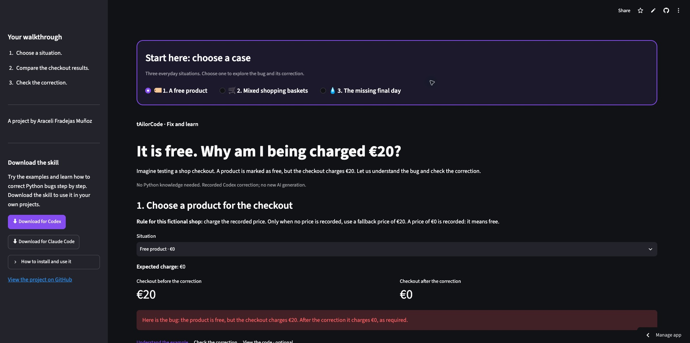
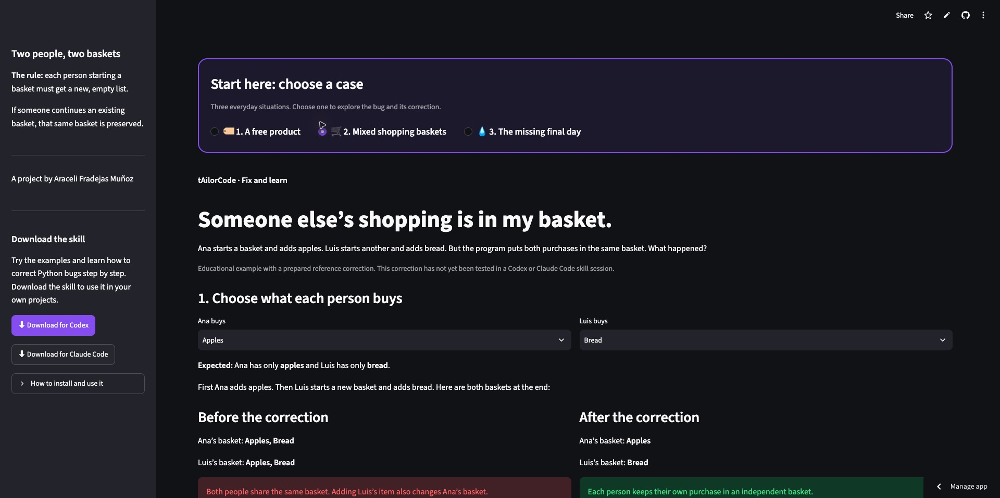
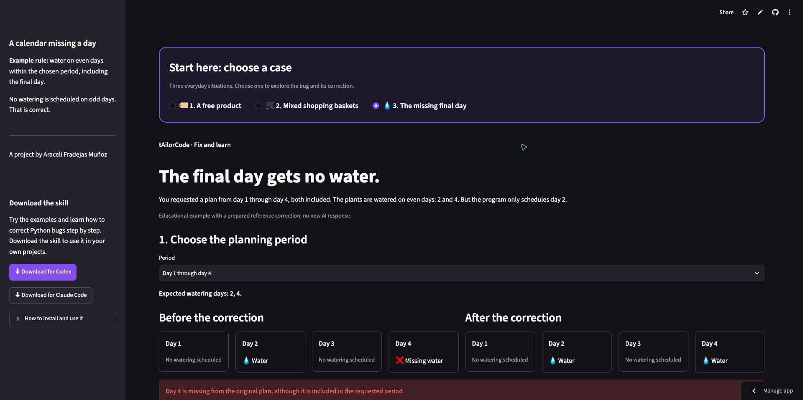
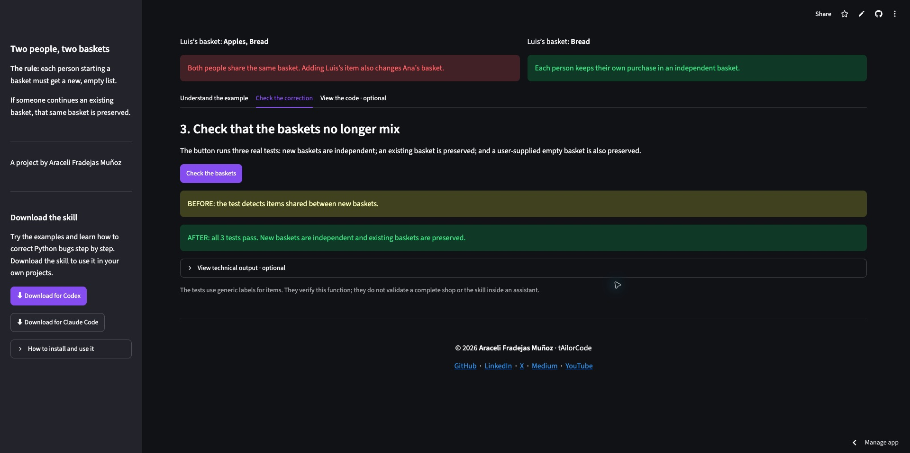

# tAilorCode — Project report

| Field | Details |
| --- | --- |
| Project | Python debugging skill and interactive learning lab |
| Author | Araceli Fradejas Muñoz |
| Origin | Kaggle Gemma developer-agent competition experiment |
| Current purpose | An independent portfolio project for learning through code repair |
| Stack | Python, Streamlit, unittest, Git and GitHub; portable Agent Skills instructions |
| Published demo | https://tailorcode-corrige-y-aprende.streamlit.app/ |
| Repository | https://github.com/AraceliFradejas/tailorcode-gemma-developer-agent |
| Release | First public version, October 17, 2026 |

## 1. Context and motivation

I started tAilorCode while exploring a Kaggle competition about developer agents
using Gemma. The original task was technical: an agent had to receive a repository
issue, inspect the relevant code, make a change, and return a patch that passed an
evaluator's tests. It connected my previous work with AI assistants to software
engineering, where a proposed answer can be checked against executable behavior.

My personal goal was broader than entering a competition. I wanted to learn how
an AI-assisted system works and build something I could explain and demonstrate
in my portfolio. After several days of environment preparation, the project could
complete one real task, but its value was still hard to see without reading logs,
configuration files, and notebook outputs.

I decided not to continue towards a competition submission. Instead, I transformed
the useful workflow into a project of my own: **tAilorCode — Fix and learn**. The
current version combines a reusable skill with a visual lab. Someone can see a
bug, understand a focused correction, and run the checks that support the result.
The competition experiment is part of the project's history, rather than its
current delivery target.

## 2. Objectives and scope

The first public version has two complementary entry points. A developer can
install the skill in an existing Python project and ask a coding assistant to
investigate an issue. A portfolio visitor can open the web demo without installing
an assistant and explore three understandable examples.

The practical objectives are:

- Make the difference between a proposed correction and a tested result visible.
- Explain a bug through observable inputs and outputs, rather than a transcript
  of an assistant's internal reasoning.
- Encourage small, reviewable changes that preserve the user's requirements.
- Package the workflow for project-local installation in Codex and Claude Code.
- Preserve evidence and limitations so the portfolio describes what actually ran.

This release does not train a model, run an online autonomous repair service, or
execute arbitrary code pasted by visitors. The web examples are prepared cases.
The downloaded skill uses the model and tools already available in its host
assistant. Host account access and usage limits still apply.

## 3. Evolution from the competition experiment

### 3.1 Preparing and packaging the original agent

The first implementation was a declarative Gemma agent configuration with prompts,
a read-only analysis sub-agent, repository tools, and evaluation limits. The
baseline under `agents/baseline/` is the preserved source of that configuration.
A self-contained notebook could reproduce the submission archive offline.

Local checks verified archive structure, configuration, and reproducible packaging.
An official compiler construction check instantiated the configuration using inert
tool bindings. That verified construction, not model performance. Earlier Kaggle
submissions showed generic system errors, and no leaderboard score was recorded.
Those errors did not establish whether the configuration or infrastructure was the
cause.

### 3.2 Completing a real Gemma task

On October 16, I used a Colab A100 to execute one public FastAPI task. Environment
preparation exposed a server compatibility problem: the HTTP instrumentation
expected router attributes that a newer FastAPI version no longer supplied in the
same way. Pinning FastAPI to 0.136.3 and checking the health and metrics endpoints
resolved that blocker before repeating inference.

The evaluator reported `resolved: true` for `fastapi_14786`, test exit code 0,
six recorded tool calls, and 43.65 seconds of evaluation time. The generated patch
normalised surrounding whitespace in the extracted credential. Preparation and
model startup were additional to the reported evaluation duration.

The session used an A100 with 40 GB of VRAM and an isolated Python environment.
The Kaggle secret was made available temporarily for preparation and revoked
before evaluation. Diagnostics were downloaded before the runtime was deleted;
Colab then showed zero active sessions and zero units per hour.

This is evidence of one public development task being solved. It is not a Kaggle
score, a general resolution rate, or a validation of the later educational skill.
The [structured result](evaluation/public-smoke-2026-10-16.json) and
[session report](docs/memoria-2026-10-16.md) preserve the distinction.

### 3.3 Turning the workflow into a personal product

The environment work taught me how fragile an AI pipeline can be, but it also
showed me that a successful tool execution does not automatically make a useful
portfolio experience. I changed the delivery goal from another competition run
to an understandable and reusable debugging workflow.

I initially considered a web interface for generating repairs through an API.
Before introducing another provider or cost, I chose to package the repair and
explanation method as a skill. The web layer then became a learning lab for
showing what a repair means, rather than pretending to be a new live model service.

## 4. Current user experience

### 4.1 The skill

The user opens a Python project in Codex or Claude Code and describes an error.
The skill asks the assistant to establish the expected behavior, inspect relevant
source and tests, attempt a reproduction, make a focused change, and run the
appropriate checks. It respects requests for diagnosis without edits.

The explanation connects the cause to the actual change and reports the commands
and observed outcomes. The skill distinguishes four states: verified by relevant
tests, syntax checked only, not verified, and unresolved. Passing focused tests
supports their tested behavior; it is not a guarantee for every possible input.

Existing acceptance tests must not be weakened to make a repair pass. Unlike the
historical competition agent, normal project development may add a meaningful
regression test. The skill does not independently authorise deployments, paid
services, commits, or pushes.

### 4.2 The visual lab

The demo begins with three visible case choices in a highlighted panel. Each case
presents a situation, the expected behavior, a before/after comparison, an
explanation, a small learning question, and a button that runs real acceptance
tests. Code and technical test output are optional details.

The first screen was initially too abstract. I could see the technical result,
but not immediately understand what the test meant. The interface was revised
to start with a fictional shop and a simple question: why is a free product being
charged at 20 euros? That feedback established the design rule for later cases:
show the situation first, then the code and tests.

## 5. The three learning examples

### 5.1 A free product charged at the fallback price

The original expression `price or fallback` treats zero as false and substitutes
the fallback. The intended rule is different: zero is a valid price, and only
`None` means the price is missing. The correction is
`fallback if price is None else price`.

The screen lets the visitor choose a free product, a registered nonzero price,
or a missing price. It displays the expected charge beside the two implementations.
The three acceptance tests cover zero, `None`, and other values including a
negative technical case. The price correction was produced in an actual Codex
conversation and independently checked against the original tests.



### 5.2 Shopping baskets that share their contents

The second example maps a mutable default list onto two fictional shopping baskets.
Ana adds an item to a new basket; Luis starts another and adds his own item. With
`labels=[]` in the function signature, both calls reuse the same list. Their
contents become mixed.

The reference correction uses `None` as the default and creates a new list inside
the function only when the caller did not supply one. The acceptance tests check
that new lists are independent, an existing supplied list keeps its identity,
and an explicitly supplied empty list is not replaced.

Each visual simulation loads fresh function definitions. This prevents the
intentionally faulty example from carrying state between simulations or visitors.
The correction is a prepared reference, not a result attributed to an unperformed
Claude or Codex session.



### 5.3 A watering plan that misses its final day

The third example presents an inclusive period in a fictional watering calendar.
Even-numbered days should receive water. From day 1 through day 4, both days 2 and
4 should be selected. The original `range(start, end)` stops before the end and
omits day 4.

The reference correction uses `range(start, end + 1)`. The interface includes a
single-day period and an odd final day, where no watering is expected on that
last day. Four acceptance tests cover those boundaries and additional technical
cases such as negative values and reversed intervals.



## 6. Technical architecture

```text
app.py                       Shared case navigation and price screen
 demo/
   engine.py                 Known-case execution, diffs and acceptance checks
   basket_view.py            Shopping-basket learning screen
   range_view.py             Inclusive-range calendar screen
   verified_*.py             Corrections displayed by the demo
   skill_downloads.py        In-memory skill ZIP generation
   footer.py                 Shared authorship and social links
skills/tailorcode/
   SKILL.md                  Portable repair-and-explanation workflow
   references/explanation.md Optional explanation guidance
   agents/openai.yaml        Codex interface metadata
examples/repair-lab/          Original exercises and acceptance tests
scripts/
   install_tailorcode_skill.py Project-local installer
   repair_lab.py               Exercise preparation and checking
   ...                         Preserved competition tools
 tests/                      Project and lab checks
 evaluation/                 Structured evidence and comparison records
 docs/                       Guides, reports and screenshots
```

Python is used throughout the active demo and lab. Streamlit provides the
interface, stateful widgets, downloads, and page reruns. The standard-library
`unittest` runner executes the acceptance tests without requiring a separate test
framework in the published app. GitHub stores the sources and triggers Streamlit
Community Cloud updates from `main`.

The requirements used for the public demo are separate from the historical GPU
stack. `requirements.txt` includes `requirements-demo.txt`, which pins the tested
Streamlit version. The deployment uses Python 3.12.

## 7. Skill packaging and installation

There is one portable source of truth for the skill. The Codex package contains
its instructions, explanation reference, and interface metadata. The Claude Code
package contains the portable instructions and reference. Both downloads are
built in memory from an explicit list of files; they do not include local
sessions, account links, logs, credentials, or dataset files.

The project-local installer copies that source into `.agents/skills/tailorcode/`
for Codex or `.claude/skills/tailorcode/` for Claude Code. It refuses to overwrite
an existing installation or workspace. It does not change global assistant
settings. A fresh conversation in the target project is used to check discovery.

Both archives were downloaded from the public deployment and inspected. That
checks distribution, not the behavior of a skill inside an assistant. The Claude
Code package is available, but its execution in Claude Code has not been tested.
The work account available during development was not used for this personal
validation.

## 8. Validation performed

| Layer | What was checked | What it establishes |
| --- | --- | --- |
| Local project checks | 37 automated tests passed at the public release checkpoint. | The exercised project, installer, fixture and demo behavior. |
| Fixtures | Each original fails assertions; handwritten reference repairs pass unchanged acceptance tests. | The exercises and their checks are usable. |
| Interface | Streamlit AppTest exercised case switching, inputs, questions and test buttons. | The tested interface paths execute without reported app exceptions. |
| Public deployment | Three real buttons passed 3, 3 and 4 acceptance tests. | The known examples and subprocess checks work in the hosted environment. |
| Public access | The app loaded in a new incognito window without signing in. | Visitors can access the deployment anonymously. |
| Downloads | Both public ZIPs were downloaded and their entries inspected. | The intended skill resources are distributed. |
| Codex usage | The recorded price repair was independently verified. | That repair satisfies the original tests. |
| Claude Code | No assistant execution performed. | No behavior claim is made. |



The screenshots show the public English interface. The original release images
are preserved privately; the publication record retains their original hashes.

The [publication record](evaluation/publication-2026-10-17.json) includes the
verification results and screenshot hashes. The images were captured from the
actual public application with browser bars hidden. They were not generated or
assembled as mockups. Older private Colab originals remain excluded from Git.

## 9. Evaluating the value of the skill

It would be misleading to assume the skill must outperform an assistant that
already knows how to debug Python. I therefore started an exploratory comparison
on the price case. The assistant produced the same one-line correction with and
without the skill installed, and both passed the three original acceptance tests.
The explanations were also similar.

No functional benefit was demonstrated in that small comparison. The experiment
also has limits: the actual model, reasoning configuration, client version and
full tool traces were not captured. A folder-selection mistake changed the
planned order, and skill reading was not directly observed. Interface durations
of 12 and 10 seconds are not a controlled latency measurement.

The honest conclusion is that the project provides a designed workflow and a
learning presentation, while its improvement over an assistant without the skill
remains unproven. The [evaluation protocol](docs/skill-evaluation.md) describes how
future matched runs should be conducted and reported without replacing failed
attempts or feeding reference corrections to the model.

## 10. Difficulties and decisions

### Environment compatibility

The Gemma phase showed why hardware allocation alone is not enough. CUDA,
package imports, health endpoints and actual evaluation are separate checks.
The FastAPI instrumentation failure was solved with a compatible version pin and
a small HTTP check before starting the expensive model work.

### Temporary cloud resources

Saving a notebook does not preserve files on its runtime. I downloaded selected
diagnostics and the generated patch before disconnecting. The displayed balance
fell from 391.34 to 389.42 compute units, but that observed 1.92-unit difference
may reflect delayed accounting; it is not a final invoice or a euro amount.
No further GPU sessions were used to build the visual lab.

### A result that was too abstract

A successful patch is meaningful technical evidence, but it did not explain the
project clearly to a portfolio visitor. Changing the focus and rewriting the
examples around everyday situations made the work easier to understand. User
feedback changed the interface, not just its decoration.

### Stale modules in the running demo

After the basket example was added, the server still held an older imported
version of the engine and raised an `ImportError` for `basket_trace`. Checks in
fresh processes had passed, so they did not reveal the old live process. Restarting
Streamlit loaded the new module and restored the screen. The local guide now
records that operational step.

### Documentation and authorship

The public README, project report and active guides are maintained in English.
The report follows the context/objectives/architecture/validation structure used
in my earlier portfolio projects, rather than acting as a raw session transcript.
Historical evidence keeps its original measured facts. The repository identifies
Araceli Fradejas Muñoz as the author and explains AI assistance without assigning
a second author to an assistant.

## 11. Publication and current status

The first public demo was deployed on October 17, 2026:

**https://tailorcode-corrige-y-aprende.streamlit.app/**

The three cases, their test buttons, the downloads, and the author footer were
checked on the live deployment. The footer links to my GitHub, LinkedIn, X, Medium
and YouTube profiles. The README includes screenshots and installation steps.

This is a completed first public version. Future work may include better evidence
of the educational benefit, matched assistant evaluations, validation in Claude
Code using a personal account, and real mobile-device testing. None of those
items is represented as already completed.

## 12. What I learned

I learned to separate model output from executable evidence, packaging from
runtime behavior, and a working technical experiment from a useful product.
I also learned that AI-generated code is not the whole project: environment
choices, verification, user explanations, scope, evidence, and deployment all
shape whether someone can understand and trust the result.

The most significant decision was changing the goal after the competition
experiment. I kept the useful work, documented its limits, and turned it into
something that reflects my own learning and can be demonstrated independently.

## Author

**© 2026 Araceli Fradejas Muñoz · tAilorCode**

[GitHub](https://github.com/AraceliFradejas) ·
[LinkedIn](https://www.linkedin.com/in/araceli-fradejas-munoz-transformaciondigital/) ·
[X](https://twitter.com/AraceliFradejas) ·
[Medium](https://medium.com/@araceli.fradejas) ·
[YouTube](https://www.youtube.com/@aracelifradejasmunoz2758)
