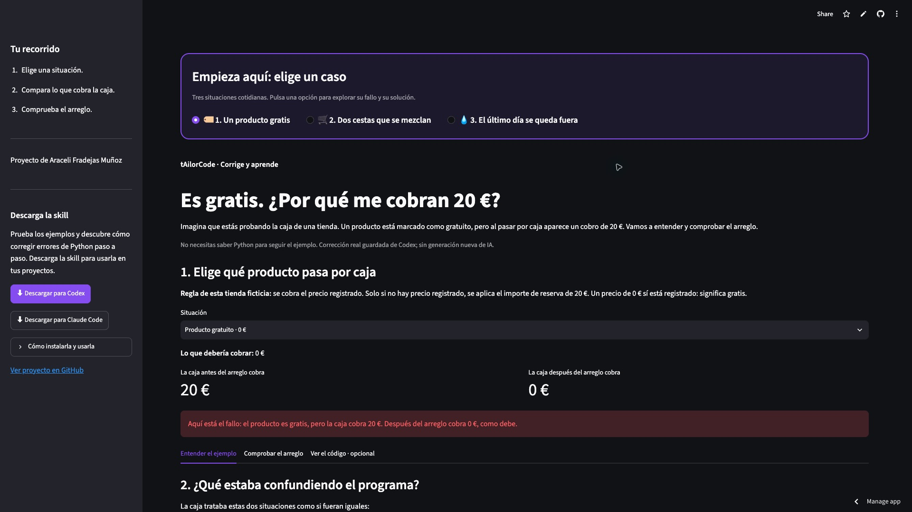
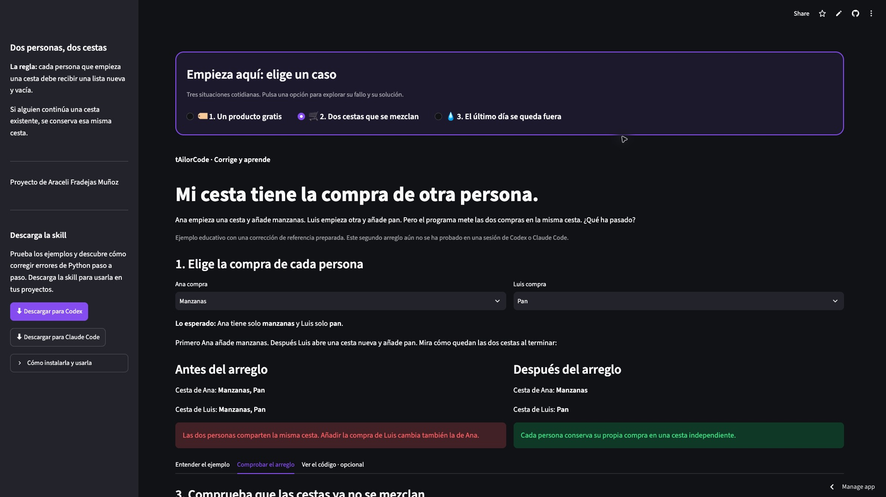
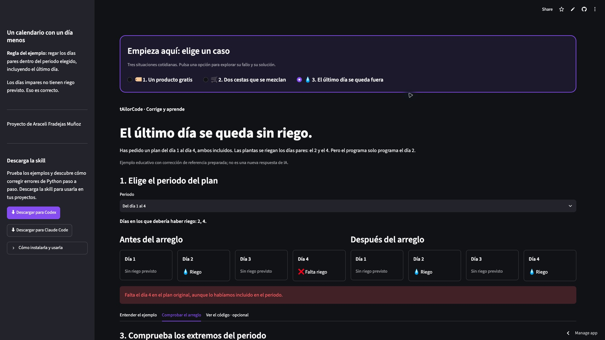
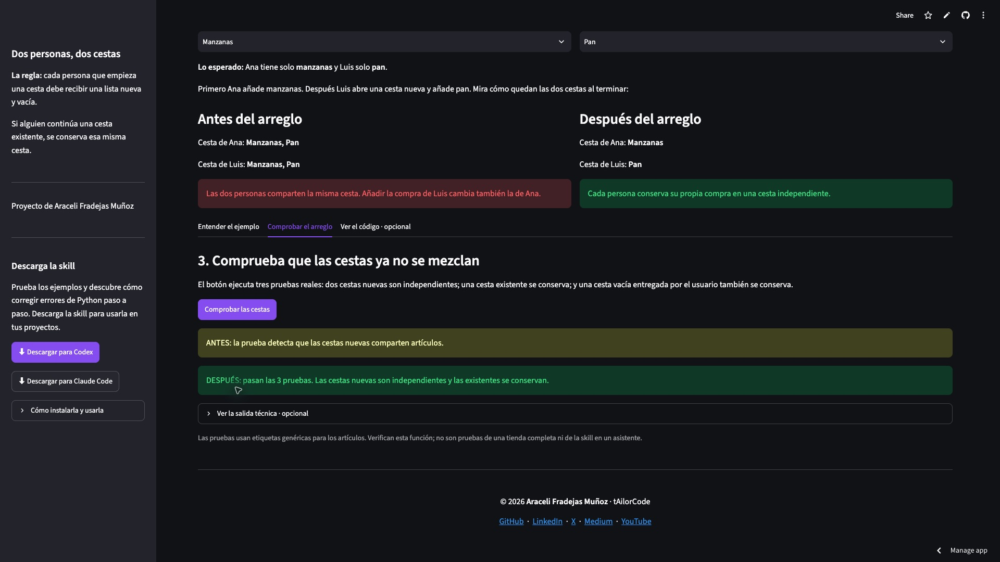

# tAilorCode · Fix and learn

**A Python debugging skill and an interactive learning lab, created and directed by Araceli Fradejas Muñoz.**

This project started as an entry for a Kaggle developer-agent competition.
I then turned it into my own educational tool: a way to understand a bug,
review a focused correction, and check the result with actual tests.

**[Try the live demo](https://tailorcode-corrige-y-aprende.streamlit.app/)** ·
[Explore the skill](skills/tailorcode/SKILL.md) ·
[Read the project journey](#from-a-kaggle-competition-to-my-own-project)

Available to download and install in **Codex and Claude Code**. A guided usage
test was completed in Codex; execution inside Claude Code has not yet been validated.
The demo, documentation, project report, and commit messages are in English.
The complete [project report](MEMORIA.md) follows the project from its Kaggle
origin through the independent educational product.

## From a Kaggle competition to my own project

I originally built tAilorCode for the **Google – The Gemma 4 Developer Agent
Competition on Kaggle**. The goal was to make an agent investigate a repository
issue, edit source code, and submit a patch that passed verification tests.

On October 16, 2026, I ran Gemma on a Colab A100 and resolved one public FastAPI
task. That was a real technical milestone, but the infrastructure work was taking
more time than the visible result. I wanted a project I could understand, use,
and show in my portfolio. I decided not to continue towards a competition submission.

I kept the useful parts—investigation, small changes, tests, and evidence—and
transformed them into **tAilorCode · Fix and learn**. The current project combines:

- **A reusable skill** that guides an existing coding assistant through a focused
  Python repair and an explanation of what was checked.
- **A visual learning lab** that turns small Python bugs into everyday situations,
  with before/after behavior and tests visitors can run themselves.
- **A documented evaluation process** that separates working examples from claims
  about whether the skill improves an assistant.

The skill uses the model and tools of its host assistant. It does not bundle Gemma
or require Kaggle, Colab, or a GPU. I did not train a model or demonstrate a general
performance improvement over other coding assistants.

The [project report](MEMORIA.md), [decision journal](docs/cambio-de-enfoque-2026-10-16.md),
and [Kaggle history](docs/historia-kaggle.md) preserve that evolution.

## Interactive demo

**[Open tAilorCode · Fix and learn](https://tailorcode-corrige-y-aprende.streamlit.app/)**

Explore three examples, compare the original and corrected behavior, run their
acceptance tests, and download the skill from the sidebar.

The screenshots below document the initial release. The live interface has since
been translated into English.



| Example | The bug | What the visitor can check |
| --- | --- | --- |
| A free product | Zero is mistaken for a missing price. | A free product must cost zero; only `None` selects the fallback. |
| Mixed shopping baskets | New calls share the same default list. | New baskets are independent; a supplied basket is preserved. |
| A missing calendar day | The final day is excluded from a range. | An inclusive watering plan includes its final even-numbered day. |

<details>
<summary>Shopping baskets: before and after</summary>



</details>

<details>
<summary>Calendar: the final day is included</summary>



</details>

<details>
<summary>Actual test results and authorship footer</summary>



</details>

The price example replays a recorded Codex correction. The basket and calendar
examples use prepared reference corrections. The web demo **does not generate
new AI responses or analyze arbitrary code**. Its buttons execute real tests on
known examples in temporary folders; their output is not simulated.

See the [publication record](docs/publicacion-streamlit.md) and
[structured verification evidence](evaluation/publication-2026-10-17.json).

## Install and use the skill

Download the ZIP for your assistant from the [live demo](https://tailorcode-corrige-y-aprende.streamlit.app/).
Extract its `tailorcode` folder into your project's skill directory:

| Assistant | Project-local installation | Example request |
| --- | --- | --- |
| Codex | `.agents/skills/tailorcode/` | `Use $tailorcode to fix this Python bug and explain how you verified the correction.` |
| Claude Code | `.claude/skills/tailorcode/` | `/tailorcode Fix this Python bug and explain how you verified the correction.` |

Start a new conversation in that project. The skill follows the user's language,
so you can ask in Spanish or English. It supports diagnosis without edits when
that is what the user requests.

If you cloned this repository, you can install into an existing project with:

```bash
python3 scripts/install_tailorcode_skill.py --target codex --project /path/to/your/project
# For Claude Code, use --target claude.
```

The installer preserves existing installations and does not change global settings.
Both downloads share the [same portable skill](skills/tailorcode/SKILL.md); the
Codex package also includes its interface metadata. Installation locations follow
the official [Codex](https://learn.chatgpt.com/docs/build-skills) and
[Claude Code](https://code.claude.com/docs/en/skills) documentation.

## What the skill adds to the workflow

The skill guides the assistant to reproduce the issue, make a focused correction,
run relevant checks, inspect the diff, and explain the cause with concrete evidence.
Its reports distinguish **verified by relevant tests**, **syntax checked only**,
**not verified**, and **unresolved**. A plausible patch is not treated as a proven fix.

This is a workflow design, not a claim that the host assistant cannot debug on its
own. In the first exploratory comparison, Codex produced the same correct patch
with and without the skill. Both versions passed the three original tests.
No functional advantage was observed in that simple case.

## Run the demo locally

Requires Python 3.10 or later; the public deployment uses Python 3.12.

```bash
python3 -m venv .venv
.venv/bin/python -m pip install -r requirements.txt
.venv/bin/python -m streamlit run app.py --server.address 127.0.0.1
```

Open the local address printed by Streamlit. If you change the structure of imported
modules while the server is running, restart the server before checking the update.
See the [local demo guide](docs/demo-local.md) for the walkthrough.

## Reproduce a repair exercise

From the repository root, prepare a fresh folder and install the skill:

```bash
python3 scripts/repair_lab.py prepare --case zero-price --workspace /tmp/tailorcode-zero-price
python3 scripts/install_tailorcode_skill.py --target codex --project /tmp/tailorcode-zero-price
```

Open that folder in your assistant, read `prompt.md`, and ask for the repair.
Then independently check the result from this repository:

```bash
python3 scripts/repair_lab.py check --case zero-price --workspace /tmp/tailorcode-zero-price
```

The original example should fail an assertion. A correct repair should pass the
original acceptance tests unchanged. Other exercises are `independent-lists` and
`inclusive-range`, under [examples/repair-lab](examples/repair-lab/).

The lab executes local Python from the exercise folder. It is **not a sandbox for
unknown code**. The prepared examples require no model calls or dataset downloads.
Walkthroughs cover [the first exercise](docs/skill-quickstart.md) and
[Claude Code setup](docs/claude-quickstart.md).

## Verification and limitations

| Area | Observed status |
| --- | --- |
| Local automated checks | 37 tests passed at the October 17 release checkpoint. |
| Skill packaging | Both archives downloaded from the public app and inspected. |
| Public app | All three examples loaded; their buttons passed 3, 3, and 4 tests respectively. Anonymous access was verified. |
| Codex usage | A guided price repair was independently checked against the original tests. |
| Claude Code usage | Package prepared; execution inside Claude Code remains untested. |
| With/without-skill comparison | One exploratory pair; same patch and passing tests. No demonstrated performance advantage. |
| Mobile | Not yet checked on a physical device. |

For local project checks:

```bash
.venv/bin/python -m pip install -r requirements-dev.txt
.venv/bin/python -m unittest discover -s tests -v
```

The [comparison protocol](docs/skill-evaluation.md) and
[partial comparison record](evaluation/skill-comparison.json) document the evidence
and its limits. The earlier [lab self-check](evaluation/skill-lab-validation-2026-10-16.json)
validates fixtures using reference corrections; it is not a model evaluation.

## Preserved Gemma milestone

The original Gemma run resolved `fastapi_14786` with test exit code 0, six recorded
tool calls, and 43.65 seconds of evaluation time. This was one public development
task, not a Kaggle score or validation of the current skill. The GPU was disconnected.

- [Structured result](evaluation/public-smoke-2026-10-16.json).
- [Detailed session report](docs/memoria-2026-10-16.md).
- [Preserved Colab notebook](notebooks/tailorcode-colab-limpio.ipynb).
- [Project report](MEMORIA.md) and [technical handoff](MEMORY.md).

Private originals, account links, and raw session diagnostics stay excluded from Git.

## Author

**© 2026 Araceli Fradejas Muñoz · tAilorCode**

[GitHub](https://github.com/AraceliFradejas) ·
[LinkedIn](https://www.linkedin.com/in/araceli-fradejas-munoz-transformaciondigital/) ·
[X](https://twitter.com/AraceliFradejas) ·
[Medium](https://medium.com/@araceli.fradejas) ·
[YouTube](https://www.youtube.com/@aracelifradejasmunoz2758)

Created and directed by Araceli Fradejas Muñoz, with AI assistance during development.
